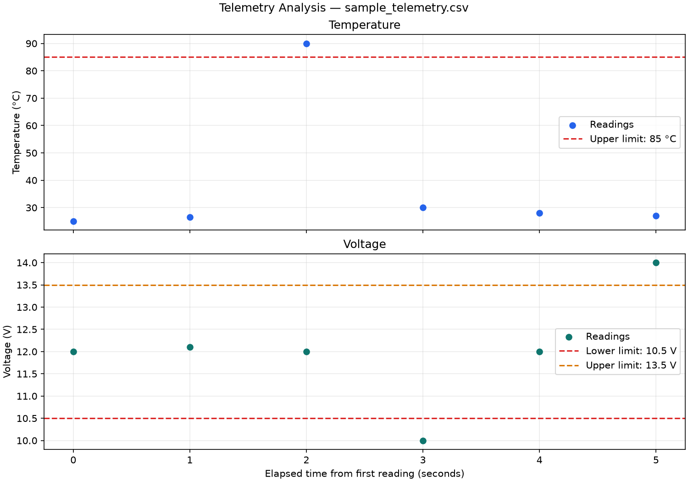
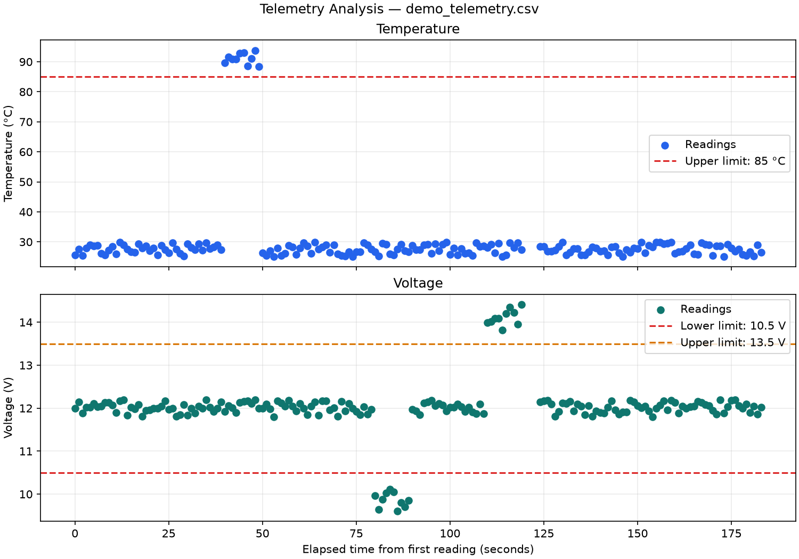

# Telemetry Log Analyzer

A Python command-line tool that reads sensor telemetry from CSV files,
detects sensor faults and timing gaps, and prints a summary.

Built as an embedded-systems and software-testing portfolio project.

## Example Chart



Sample telemetry showing an overtemperature reading at two seconds,
undervoltage at three seconds, and overvoltage at five seconds.

## Demonstration Scenario

The synthetic demonstration contains 180 readings spanning 183 seconds.
It includes normal operation, overtemperature, undervoltage, overvoltage,
communications failure, and recovery after each fault.

One five-second interval represents four missing expected samples.



Communications failures are included in the terminal and JSON reports;
the chart displays temperature and voltage.

Generate the demonstration log at a new destination:

```bash
python3 scripts/generate_demo.py data/demo_telemetry.csv
```

If the demonstration file already exists, analyze it directly:

```bash
python3 analyzer.py data/demo_telemetry.csv
```

Expected summary:

```text
Total readings: 180
Readings with faults: 35
Readings without faults: 145
Timing gaps: 1
```

## Features

- Detects temperatures above 85 °C
- Detects voltages below 10.5 V or above 13.5 V
- Flags communications failures
- Detects timestamp gaps exceeding a configurable interval (default: one second)
- Rejects duplicate or decreasing timestamps
- Validates required columns, row completeness, numeric values,
  communications values, and timestamps
- Includes line numbers in row-validation errors
- Exports structured JSON reports
- Can create temperature and voltage charts with the optional Matplotlib dependency
- Core analysis uses only the Python standard library

Timing gaps are reported separately from sensor faults.

## Requirements

Python 3.14. Development and local verification used Python 3.14.4
on Ubuntu through Windows Subsystem for Linux (WSL).

Core analysis and JSON export require no third-party packages. Chart
generation requires the optional Matplotlib dependency; see [Generate a
Chart](#generate-a-chart).

## Input Format

Required column names are case-sensitive. By default, the analyzer accepts
additional named columns and any column order, while requiring all four
analysis fields. Use `--strict-contract` to validate producer output against
version 1 of the telemetry contract.

```csv
timestamp,temperature_c,voltage_v,comms_ok
2026-10-22T10:00:00,25.0,12.0,true
2026-10-22T10:00:01,90.0,12.0,true
```

- Timestamps must include a date and time separated by `T`.
- Timestamps must consistently include or omit timezone information.
- Temperature and voltage must be finite numbers.
- Communications values must be `true` or `false`, ignoring
  capitalization and surrounding spaces.
- Use --expected-interval SECONDS to set the expected time between readings.

The versioned producer/consumer specification is documented in
[Telemetry CSV Contract](docs/telemetry_contract.md).

## Run

From the project folder:

```bash
python analyzer.py
```

Analyze a different log:

```bash
python analyzer.py path/to/log.csv
```

Analyze readings expected every two seconds:

```bash
python3 analyzer.py data/sample_telemetry.csv --expected-interval 2
```

The interval must be a positive, finite number. An interval exactly at
the configured threshold does not count as a gap.

### Generate Demo Telemetry

Create a reproducible 180-reading demo log:

```bash
python3 scripts/generate_demo.py
```

By default, the script creates `data/demo_telemetry.csv` and refuses to
overwrite an existing file. Pass a destination path to choose another file.

### Export a JSON Report

Create the output folder:

```bash
mkdir -p reports
```

Export an analysis:

```bash
python3 analyzer.py --expected-interval 2 --output reports/report.json
```

The report includes the source path, expected interval, summary counts,
sensor faults, and timing gaps.

The destination folder must already exist. Existing files are not
overwritten; choose a new filename for each export. Invalid logs produce
no analysis output and no report.

### Health Monitor Integration

With `rtos-system-health-monitor` checked out beside this repository,
build the C++ executable and run the reproducible bridge:

```bash
python3 scripts/run_health_monitor_demo.py
```

The script discovers a native executable for the running platform. In WSL
and Linux, it checks `build-wsl/rtos_health_monitor` before
`build/rtos_health_monitor` and does not automatically select Windows `.exe`
files. On Windows, it checks `.exe` builds under `build/Debug`,
`build/Release`, `build`, and `build-wsl`.

It creates timestamped CSV, JSON report, and manifest files under the
health-monitor project's `logs/` directory, and invokes the analyzer.

Use `--monitor-root` for a non-sibling checkout or `--monitor` for an
explicit executable. An explicit path takes precedence over discovery;
an invalid path reports an error instead of selecting another build:

```bash
python3 scripts/run_health_monitor_demo.py \
  --monitor-root /path/to/rtos-system-health-monitor \
  --monitor /path/to/rtos_health_monitor
```

The 1.05-second threshold is configurable with `--expected-interval`.
Capture duration and sampling interval can be set with `--duration` and
`--telemetry-interval-ms`. The generated manifest records start and completion
times, capture settings, and repository revisions.

### Generate a Chart

Install the optional plotting dependencies:

```bash
python3 -m pip install -r requirements-plot.txt
```

Create the output folder:

```bash
mkdir -p reports
```

Create a chart:

```bash
python3 analyzer.py --plot reports/telemetry.png
```

The PNG contains temperature and voltage readings with fault thresholds
marked. Existing destination files are not overwritten.

Display help:

```bash
python analyzer.py --help
```

## Sample Summary

```text
Telemetry Summary
Total readings: 6
Readings with faults: 4
Readings without faults: 2
Timing gaps: 0
```

## Tests

```bash
python -m unittest discover -s tests -v
```

Tests cover fault thresholds, input validation, timestamp ordering,
timing gaps, file-reading integration, and command-line behavior.
Chart rendering tests run when Matplotlib is installed.

GitHub Actions runs the automated tests and sample analysis on every push
and pull request using Python 3.14, both with and without Matplotlib.

## Limitations

- Analysis stops at the first invalid record.
- This is an offline analysis tool, not a real-time monitoring system.
